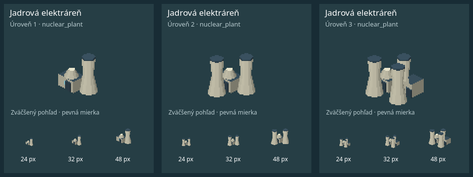
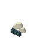
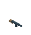
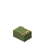
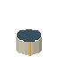
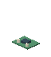

# Atlas: opravené modely a tri vizuálne úrovne

> Hráč schválil [výškovú banku, kasíno a hotel](atlas-towers-proposal/README.md); všetkých deväť variantov je zapojených do Atlas sady. Ostatné budovy sú tiež schválené.

Nadväzujúca etapa: [Atlas mapa podľa HOI4 PDF — zmeny, licencie a päť pohľadov pred/po](atlas-map-style/README.md). Schválené modely zostávajú nezmenené.

Aktualizácia 29. 10. 2026. **V Atlase je nasadená vlastná jednotná pixelová sada pre všetkých 61 podnikov.** Ďalšie štyri mapové objekty majú pripravené varianty. Spolu 65 typov × 3 úrovne = **195 odlišných exteriérov**. Nejde o stiahnuté 3D meshe: využitá je povolená alternatíva vlastných izometrických pixelových modelov.

[Galéria všetkých typov a úrovní](atlas-levels/README.md) · [lokálna filtrovaná galéria](atlas-levels/index.html) · [195 jednotlivých snímok](atlas-levels/individual/) · [pôvod a podmienky vlastnej grafiky](../assets/map_models/levels/README.md)

## Čo sa zmenilo

- Externé výsledky so spoločnými kanceláriami, interiérmi a nejasným významom nahradili vlastné exteriéry s typovými dominantami. Žiadny Sketchfab model nebol prevzatý do hry. Staré odkazy sú zachované iba ako historický prieskum na konci dokumentu.
- Kancelárie, logistika, ambulancia/nemocnica, letecká firma/lietadlo a prístav/terminál sa rozlišujú stavbou a vybavením. Tabuľka nižšie uvádza motív každého typu.
- Chýbajúce `auto_plant`, `chip_fab`, `copper_mine`, `electronics_plant`, `gas_plant`, `restaurant` majú vlastné modely v troch úrovniach. Pre `crude_oil` a `fuel` sú hotové vlastné pixelové návrhy v dokumentácii.
- `farm` zo zadania zodpovedá hernému ID `wheat_farm`, `nuclear` zodpovedá `nuclear_plant`. Žiadne nové druhy firiem sa nezaviedli.
- Existujúce UI ikony, menu a 3D skúška zostali nezmenené. Nová sada sa načítava iba cez vykresľovanie Atlasu. Pôvodné súbory sa neodstraňujú.

## Upgrady a kompatibilita

`IndustrySystem.upgrade_firm` naďalej používa pôvodné náklady, odomykanie a násobiteľ výkonu 1,35. Po úspechu emituje prezentačný signál. Atlas načíta variant podľa existujúceho `firm.level`; starý save bez levelu používa úroveň 1.

Úroveň 2 pridáva podľa typu bočné krídlo, poschodie, panelovú radu alebo technológiu. Úroveň 3 pridáva ďalšie krídlo, vyšší blok alebo ďalšie vybavenie. Manifest zaznamenáva rozmery a diely: pri každom kroku narastie aspoň jeden priestorový rozmer a pribudne alebo sa zmení geometria. Každá trojica používa **rovnakú projekciu a kotvu**; varianty nevznikajú zväčšením hotového obrázka.

Prechod trvá 0,55 s a prelína starý a nový variant. Rýchle dva upgrady nadväzujú na rozpracovaný prechod. Kliknutia zohľadňujú viditeľné diely aj počas prechodu. Načítanie iného sveta vymaže animácie. Animácia sa neukladá, nepoužíva herný RNG a funguje aj pri pozastavenej simulácii. Save formát **v3 zostáva nezmenený**.

**Hranica existujúcej logiky:** `bank`, `hq`, `port`, `highway` nemajú priemyselný upgrade 1–3. Majú pripravené všetky tri grafické varianty, ale v hre ostávajú na úrovni 1. Ich L2/L3 snímky sú ukážky variantov, nie dôkaz nového herného upgrade systému.

## Opravené komoditné návrhy — UI sa nemení

Tieto obrázky sú návrhy na kontrolu v `docs/`, nie náhrady existujúcich UI ikon. Komodity nie sú samostatné budovy Atlasu a nepodliehajú levelom budov.

| ID | Nový motív | Náhľad |
| --- | --- | --- |
| `pmc` | Štít s odznakom; baterka vyradená |  |
| `finance` | Stohy mincí; aktovka vyradená |  |
| `ai_services` | Serverový cloud; interiér vyradený |  |
| `weapons` | Puška |  |
| `arms` | Muničná debna |  |
| `crude_oil` | Valcový zásobník s plávajúcou strechou; tlaková guľa a barel vyradené |  |
| `fuel` | Moderný výdajný stojan s pištoľou; hrdzavé historické rekvizity vyradené |  |
| `electronics` | Bežná osadená doska elektroniky; futuristický mikro čip vyradený |  |

`aircraft` zostáva lietadlo v existujúcom UI; `airline` na Atlase má dominantný chvost s vlastným znakom. `arms_plant` je výrobný podnik, `arms` komodita a `pmc_unit` bezpečnostný podnik — tieto významy sa nezamieňajú.

## Pôvod, licencie a atribúcie

Všetkých 195 modelov a osem komoditných návrhov je pôvodná geometrická pixelová tvorba pre tento repozitár. Zdroj: [`tools/atlas/generate_levels.py`](../tools/atlas/generate_levels.py). Generátor používa explicitné stavebné diely, vlastné znaky a jednotnú paletu, žiadne externé textúry ani modely. Nejde o obrázky vytvorené generatívnym obrazovým nástrojom.

V manifeste je pôvod označený `LicenseRef-Projekt47-Original`. Nie je to tvrdenie, že pôvodná grafika je licencovaná zo Sketchfabu pod CC0/CC-BY; verejná distribučná licencia projektu sa touto zmenou nemení. **Použité Sketchfab aktíva: žiadne. Požadované atribúcie externých modelov: žiadne.** Historické vyhľadávacie označenia CC-BY nie sú schválením ich pôvodu ani povolením použiť ich obsah.

## Overenie a snímky

- Godot **4.7.2**, Xvfb, GL Compatibility, Mesa **llvmpipe**. Ide o skutočné snímky renderera, nie externé náhľady.
- 65 prehľadových snímok po troch úrovniach, 195 samostatných výrezov z týchto snímok, 13 strán na skutočnom Atlase a 10 snímok úspešných upgradov jadrovej elektrárne.
- Každý prehľad ukazuje rovnakú trojicu aj pri šírke obrazovej plochy 24, 32 a 48 px. Budova môže byť menšia než obrazová plocha kvôli priehľadnému okraju a miestu pre rast.
- **49 cielených testov prešlo:** 20 nových kontrol úrovní, 22 existujúcich Atlas regresií a 7 kontrol pôvodných UI ikon. Jeden skupinový audit aktív navyše overil úplnosť, rast geometrie, spoločnú projekciu, neorezané okraje a žiadne identické obrázky pri 24/32/48/64 px. Spolu 50 kontrol, nie plná testovacia sada.
- [Výsledky a príkazy](atlas-levels/validation.txt). Nezhodné kontrolné súčty samy osebe nedokazujú rozpoznateľnosť; na jej posúdenie sú priložené snímky všetkých typov.

## Otvorené položky

1. Výtvarný výsledok budov je schválený hráčom vrátane prepracovanej výškovej banky, kasína a hotela. Ďalšie vizuálne práce sa presúvajú na podklad Atlas mapy.
2. Nová upgrade logika pre banku, HQ, samostatný prístavný žeriav a diaľnicu nebola vytvorená. Ich grafické varianty L2/L3 ostávajú pripravené na budúce napojenie.
3. Komoditné návrhy zostávajú iba v dokumentácii, pretože zadanie zakazuje meniť existujúce UI ikony. Žiadna z ôsmich pôvodne chýbajúcich položiek už nie je bez vlastného návrhu.
4. Nevykonal sa používateľský test rozpoznávania ani záťažový benchmark veľkého počtu súčasných upgradov; výsledky netvrdia garantované FPS.

## Súpis všetkých typov

Každý odkaz otvorí skutočný prehľad úrovní 1/2/3 aj pri 24/32/48 px. Tabuľka opisuje aktuálny vlastný model, nie historický externý kandidát.

| ID / názov | Rozlišovací motív | Tri úrovne |
| --- | --- | --- |
| `cafe` — Kaviareň | Kaviareň so štítom a vonkajším slnečníkom | [Snímka L1–L3](atlas-levels/cafe.png) |
| `wheat_farm` — Farma | Stodola, obilné pole a silo | [Snímka L1–L3](atlas-levels/wheat_farm.png) |
| `coffee_farm` — Plantáž | Plantáž s kávovníkmi a stodolou | [Snímka L1–L3](atlas-levels/coffee_farm.png) |
| `livestock` — Chov | Farma so stodolou a zvieratami | [Snímka L1–L3](atlas-levels/livestock.png) |
| `oil_well` — Ropný vrt | Ťažobné čerpadlo s vahadlom a obslužnou budovou | [Snímka L1–L3](atlas-levels/oil_well.png) |
| `coal_mine` — Uhoľná baňa | Ťažná veža so zvislým kolesom a kopou uhlia | [Snímka L1–L3](atlas-levels/coal_mine.png) |
| `iron_mine` — Baňa na rudu | Stupňovitá rudná baňa s dopravníkom | [Snímka L1–L3](atlas-levels/iron_mine.png) |
| `copper_mine` — Medená baňa | Stupňovitá medená baňa, obslužná budova a manipulačný žeriav | [Snímka L1–L3](atlas-levels/copper_mine.png) |
| `power_coal` — Elektráreň | Turbínová hala, červené komíny a zásoba uhlia | [Snímka L1–L3](atlas-levels/power_coal.png) |
| `steel_mill` — Oceliareň | Tehlová oceliareň, vysoká pec a žeravá oceľ | [Snímka L1–L3](atlas-levels/steel_mill.png) |
| `chem_plant` — Chemička | Procesné nádoby a prepojené potrubie na hale | [Snímka L1–L3](atlas-levels/chem_plant.png) |
| `pharma_lab` — Laboratórium | Laboratórna budova s krížom a chladením | [Snímka L1–L3](atlas-levels/pharma_lab.png) |
| `textile_mill` — Textilka | Textilná hala so sedlovou strechou, komínom a cievkami | [Snímka L1–L3](atlas-levels/textile_mill.png) |
| `electronics_plant` — Elektronika | Výrobná hala, strešné svetlíky a zelený elektronický znak | [Snímka L1–L3](atlas-levels/electronics_plant.png) |
| `auto_plant` — Automobilka | Montážna hala, automobilový znak a hotové vozidlo | [Snímka L1–L3](atlas-levels/auto_plant.png) |
| `arms_plant` — Zbrojovka | Tehlová zbrojovka s obranným emblémom a muničnou debnou | [Snímka L1–L3](atlas-levels/arms_plant.png) |
| `construction_co` — Stavbár | Stavebný areál s vežovým žeriavom a materiálom | [Snímka L1–L3](atlas-levels/construction_co.png) |
| `logistics_hub` — Logistika | Nízke prekladisko, kamióny a rampy | [Snímka L1–L3](atlas-levels/logistics_hub.png) |
| `finance_office` — Finančná kancelária | Finančná budova s mincovým emblémom | [Snímka L1–L3](atlas-levels/finance_office.png) |
| `pmc_unit` — Súkromná bezpečnosť | Bezpečnostná základňa so štítom | [Snímka L1–L3](atlas-levels/pmc_unit.png) |
| `trade_desk` — Obchodná kancelária | Kancelária s vonkajšou obrazovkou kurzov | [Snímka L1–L3](atlas-levels/trade_desk.png) |
| `restaurant` — Reštaurácia | Európska reštaurácia s komínom a zastrešenou terasou | [Snímka L1–L3](atlas-levels/restaurant.png) |
| `bakery` — Pekáreň | Európska pekáreň, sedlová strecha, komín a chlieb na štíte | [Snímka L1–L3](atlas-levels/bakery.png) |
| `gym` — Fitko | Športová budova s dominantnou činkou | [Snímka L1–L3](atlas-levels/gym.png) |
| `auto_service` — Autoservis | Servisná hala so znakom auta a vozidlom | [Snímka L1–L3](atlas-levels/auto_service.png) |
| `eshop` — E-shop | Expedičná hala, dodávka a balíky | [Snímka L1–L3](atlas-levels/eshop.png) |
| `real_estate` — Realitka | Dom so sedlovou strechou a ceduľou PREDAJ | [Snímka L1–L3](atlas-levels/real_estate.png) |
| `hotel` — Hotel | Výškový hotel s balkónmi, strešným bazénom a krytým príjazdom | [Snímka L1–L3](atlas-levels/hotel.png) |
| `supermarket` — Supermarket | Predajná hala s dlhým zeleným označením | [Snímka L1–L3](atlas-levels/supermarket.png) |
| `warehouse` — Logistika a sklady | Vysoká regálová hala s rebrovaným exteriérom | [Snímka L1–L3](atlas-levels/warehouse.png) |
| `software` — Softvérová firma | Kancelária so symbolom kódu | [Snímka L1–L3](atlas-levels/software.png) |
| `ad_agency` — Reklamná agentúra | Strešný billboard na kancelárii | [Snímka L1–L3](atlas-levels/ad_agency.png) |
| `clinic` — Súkromná klinika | Nízka ambulancia s červeným krížom | [Snímka L1–L3](atlas-levels/clinic.png) |
| `chip_fab` — Výroba čipov | Uzavretá čistá výroba s technickým strešným blokom a odťahmi | [Snímka L1–L3](atlas-levels/chip_fab.png) |
| `airline` — Letecká spoločnosť | Prevádzková budova a dominantný chvost lietadla s vlastným znakom | [Snímka L1–L3](atlas-levels/airline.png) |
| `telecom` — Telekom | Telekomunikačná budova s vysokým anténovým stožiarom | [Snímka L1–L3](atlas-levels/telecom.png) |
| `solar_plant` — Solárna elektráreň | Rady solárnych panelov a meničová budova | [Snímka L1–L3](atlas-levels/solar_plant.png) |
| `gas_plant` — Plynová elektráreň | Turbínové bloky a dvojica svetlých výfukových komínov | [Snímka L1–L3](atlas-levels/gas_plant.png) |
| `nuclear_plant` — Jadrová elektráreň | Reaktorový blok s kupolou a chladiace veže | [Snímka L1–L3](atlas-levels/nuclear_plant.png) |
| `shipyard` — Lodenica | Lodenica s halou, dvoma žeriavmi a rozostavanou loďou | [Snímka L1–L3](atlas-levels/shipyard.png) |
| `insurance` — Poisťovňa | Modrý panel s dáždnikom na fasáde | [Snímka L1–L3](atlas-levels/insurance.png) |
| `invest_fund` — Investičný fond | Štíhla sklenená veža | [Snímka L1–L3](atlas-levels/invest_fund.png) |
| `tv_station` — Televízia | Štúdiová budova so satelitnými taniermi | [Snímka L1–L3](atlas-levels/tv_station.png) |
| `social_network` — Sociálna sieť | Kampus s vlastným symbolom prepojenia | [Snímka L1–L3](atlas-levels/social_network.png) |
| `newspaper` — Noviny | Tehlová tlačiareň s komínom a novinovým štítom | [Snímka L1–L3](atlas-levels/newspaper.png) |
| `casino` — Kasíno | Dve zlaté výškové veže, neónové pásy a diamantový vstupný znak | [Snímka L1–L3](atlas-levels/casino.png) |
| `offshore` — Offshore firma | Vila, palma a bazénová terasa | [Snímka L1–L3](atlas-levels/offshore.png) |
| `airport` — Letisko | Terminál, riadiaca veža a značenie letiskovej plochy | [Snímka L1–L3](atlas-levels/airport.png) |
| `oil_refinery` — Ropná rafinéria | Destilačné kolóny, technologická hala a valcová nádrž | [Snímka L1–L3](atlas-levels/oil_refinery.png) |
| `gas_works` — Plynáreň | Plynárenská hala so zásobníkom a odťahom | [Snímka L1–L3](atlas-levels/gas_works.png) |
| `stock_broker` — Burza / obchodník s cennými papiermi | Burzová kancelária s kurzovou obrazovkou a zlatou kupolou | [Snímka L1–L3](atlas-levels/stock_broker.png) |
| `gas_well` — Vrt na zemný plyn | Vrtná veža, potrubie a ventil | [Snímka L1–L3](atlas-levels/gas_well.png) |
| `aircraft_plant` — Letecká továreň | Výrobný hangár s celým lietadlom | [Snímka L1–L3](atlas-levels/aircraft_plant.png) |
| `data_center` — Dátové centrum | Uzavretá hala s dvojicou strešných chladiacich jednotiek | [Snímka L1–L3](atlas-levels/data_center.png) |
| `ai_firm` — AI firma | Serverové skrine na streche a anténa | [Snímka L1–L3](atlas-levels/ai_firm.png) |
| `hospital` — Súkromná nemocnica | Viacposchodová nemocnica s krížom | [Snímka L1–L3](atlas-levels/hospital.png) |
| `cargo_port` — Nákladný prístav | Kontajnerový terminál, žeriav a loď s kontajnermi | [Snímka L1–L3](atlas-levels/cargo_port.png) |
| `school_primary` — Súkromná základná škola | Škola so sedlovou strechou, vlajkou a ihriskom | [Snímka L1–L3](atlas-levels/school_primary.png) |
| `school_high` — Súkromná stredná škola | Školská budova s hodinovou vežou | [Snímka L1–L3](atlas-levels/school_high.png) |
| `university` — Súkromná univerzita | Univerzita s portikom, stĺpmi a kupolou | [Snímka L1–L3](atlas-levels/university.png) |
| `corp_academy` — Firemná akadémia | Školiace centrum so zeleným znakom a presklenou časťou | [Snímka L1–L3](atlas-levels/corp_academy.png) |
| `bank` — Banka | Výšková finančná veža so stĺpovým vstupom a zlatou stupňovitou korunou | [Snímka L1–L3](atlas-levels/bank.png) |
| `hq` — Centrála | Najvyššia kancelárska veža s heliportom | [Snímka L1–L3](atlas-levels/hq.png) |
| `port` — Prístavný žeriav | Samostatné prístavné žeriavy na móle | [Snímka L1–L3](atlas-levels/port.png) |
| `highway` — Diaľnica | Diaľničný most na pilieroch | [Snímka L1–L3](atlas-levels/highway.png) |

Historický prieskum externých modelov — nepoužitý, nahradený vlastnou sadou vyššie

# Ikony podľa skutočných funkcií Projektu-47

Projekt-47 je ekonomická stratégia: hráč zakladá a riadi firmy na svetovej mape, nakupuje výrobné vstupy, predáva produkty, spravuje zamestnancov, úvery, banky, akcie a korporácie. Politika, výskum, mestá a logistika menia podmienky podnikania. Ikona má vysvetliť tento objekt alebo činnosť.

Preskúmané: README, všetkých 61 podnikov, 28 komodít a recepty, popisy činností, výstavba, mapa, detail firmy, bankové vetvenie detailu, horná lišta, úvery, burza, portfólio a menu. Prezretá bola aj uložená banková snímka. Nie je to nové kompletné grafické prehranie celej hry. Existujúca headless sada `goods_icons_unit` prešla 7/7 kontrolami.

- **Podniky:** areál alebo budova s rozpoznateľnou technológiou. Elektronika ako podnik = montážny závod; výroba čipov = polovodičová fabrika. Vrt, rafinéria a plynáreň majú odlišné siluety.
- **Komodity:** menšie obrázky materiálov, produktov a služieb v riadkoch vstupov/výstupov. Elektronická zostava tu nesmie nahradiť budovu firmy.
- **Ďalšie existujúce ikony:** banka, HQ, diaľnica a prístav. Banka má samostatný herný systém mimo 61 druhov priemyslu.
- **Ovládanie:** pauza, rýchlosti, zatvorenie, posun, vrstvy a navigácia sú dnes prevažne textové ovládače. Nejde o ďalšie druhy podnikov; 3D rekvizita pre každé tlačidlo by význam skôr znejasnila. Ich úplný budúci grafický súpis je samostatná otvorená časť UI.

Používateľ odmietol futuristický Microchip - Prototype a Barrel 01 pre ropu/palivo; nepoužiť ich. Hľadanie pokrylo všetkých 93 existujúcich obrázkových ikon, pri slabých výsledkoch bolo spresnené. Odkazy nižšie sú **námety na ďalšie overenie, nie schválené alebo stiahnuté modely**. Niektoré sú iba časťou potrebnej scény. Žiadny z nich nie je potvrdený ako finálna ikona. Chýbajúce vhodné výsledky zostávajú otvorené.

Licencia v tabuľke je označenie vo verejnom vyhľadávacom API Sketchfabu; pôvod a oprávnenie autora, prípadné generovanie AI a práva k všetkým súčastiam treba overiť na konkrétnom balíku. Náhľady sú pôvodné náhľady autorov, nie snímky z našej hry. Výkon, export a čitateľnosť 24/32/48 px neboli merané. Na podrobné zobrazenie slúži [obrázkový katalóg HTML](PREBETA_09_PRIESKUM_IKON.html), záznam dotazov a posúdených kandidátov je v [JSON](PREBETA_09_PRIESKUM_IKON.json).

Kontrola podrobných popisov pôvodných 89 kandidátov odhalila jeden výslovne AI generovaný model; bol vyradený a nahradený. Po kontrole zostáva 85 predbežných námetov a 8 otvorených položiek. Toto číslo neznamená 85 vizuálne overených alebo použiteľných modelov. Pri každej položke je uvedený rozsah kontroly.

## Desať námetov na rýchlu vizuálnu kontrolu

Náhľady autorov zo zdrojových stránok. Ide o jednotlivé námety, nie desať ucelených výtvarných smerov ani snímky z hry.

| Námet | Námet |
| --- | --- |
| **Ropný vrt** — Felnev · CC Attribution  Náhľad videný: realistická silueta ťažobného čerpadla zodpovedá činnosti podniku. | **Jadrová elektráreň** — thomass3278 · CC Attribution  Náhľad videný: obsahuje chladiace veže, ale nie kompletnú elektráreň. Ovládací panel a barel nie sú motívom ikony. |
| **Nákladný prístav** — Vitaliy Kovalchuk · CC Attribution  Náhľad videný: prístavný žeriav; treba doplniť mólo, kontajnery a vhodnú loď. | **Oceliareň** — Metazeon · CC Attribution  Náhľad a popis skontrolované: autor uvádza fotogrametriu DJI Mavic3/RealityScan. Veľký oceliarsky areál; hustotu geometrie, balík a čitateľnosť ešte overiť. |
| **Ropná rafinéria** — Chenzoss · CC Attribution  Náhľad skontrolovaný: kompaktný priemyselný blok s nádržami a potrubím; nie kompletná rafinéria s overeným technologickým usporiadaním. Zatiaľ len námet. | **Chemička** — Bimfra · CC Attribution  Náhľad videný: biely technický model potrubia; chýbajú hotové materiály a čitateľná dominantná budova. |
| **Letisko** — Awesome Ploy 3D · CC Attribution  Predbežne vecne príbuzný výsledok; náhľad, pôvod, licencia celého balíka, mierka a import ešte vyžadujú overenie. | **Logistika a sklady** — rajibkc · CC Attribution  Predbežne vecne príbuzný výsledok; náhľad, pôvod, licencia celého balíka, mierka a import ešte vyžadujú overenie. |
| **Elektronika** — braeburn · CC Attribution  Náhľad videný: súčasná doska elektroniky. Patrí len medzi vstupy/výstupy výroby; nie ako ikona výrobného podniku. | **Mäso** — KIMMEN_AWIP · CC Attribution  Náhľad a popis skontrolované: PBR model surového mäsa; nahrádza výslovne AI generovaný výsledok. Import a pôvod celého balíka ešte neoverené. |

## Podniky a mapové objekty

| ID a význam | Hľadaný motív | Model / autor / licencia podľa zdroja | Stav |
| --- | --- | --- | --- |
| `ad_agency` — Reklamná agentúra | Kancelária reklamnej agentúry | [Office Building game ready ](https://sketchfab.com/3d-models/e34f775f852c4f1aa2beb6ef3dcce015) — MangoGames — CC Attribution | Predbežne vecne príbuzný výsledok; náhľad, pôvod, licencia celého balíka, mierka a import ešte vyžadujú overenie. |
| `ai_firm` — AI firma | Vývojová kancelária s výpočtovým pracoviskom | [Small Office ](https://sketchfab.com/3d-models/393a8fec31bf41a99a49a57bbcf02ac8) — dylanheyes — CC Attribution | Predbežne vecne príbuzný výsledok; náhľad, pôvod, licencia celého balíka, mierka a import ešte vyžadujú overenie. |
| `aircraft_plant` — Letecká továreň | Montážny hangár s lietadlom | [Aircraft Hangar ](https://sketchfab.com/3d-models/a5b17ba2e3494873abd313f720097614) — jimbogies — CC Attribution | Hangár je iba základ; chýba overená montážna linka. |
| `airline` — Letecká spoločnosť | Dopravné lietadlo ako značka leteckej spoločnosti | [Airplane ](https://sketchfab.com/3d-models/53778f73ca764558b48578ca5e41f5d3) — DrRicardoFan — CC Attribution | Predbežne vecne príbuzný výsledok; náhľad, pôvod, licencia celého balíka, mierka a import ešte vyžadujú overenie. |
| `airport` — Letisko | Terminál, dráha a stojisko lietadla | [Airport ](https://sketchfab.com/3d-models/8acd6dcbd6464f38a7e6687745b3eb33) — Awesome Ploy 3D — CC Attribution | Predbežne vecne príbuzný výsledok; náhľad, pôvod, licencia celého balíka, mierka a import ešte vyžadujú overenie. |
| `arms_plant` — Zbrojovka | Priemyselný výrobný závod zbraní | [WEAPONS' FACTORY ](https://sketchfab.com/3d-models/da9519d56eb94a38bbcbc67b948f40ba) — a108082046 — CC Attribution | Predbežne vecne príbuzný výsledok; náhľad, pôvod, licencia celého balíka, mierka a import ešte vyžadujú overenie. |
| `auto_plant` — Automobilka | Automobilová hala s montážnou linkou | Zatiaľ bez vhodného kandidáta | Výsledky ukazovali autá alebo všeobecné továrne, nie vhodnú automobilovú montážnu halu. |
| `auto_service` — Autoservis | Servisná dielňa s otvorenými bránami | [Martín's Car Repair Garage ](https://sketchfab.com/3d-models/02ed06b409b94bbca4a7870c0d7016b4) — Hendrik Ogg — CC Attribution | Predbežne vecne príbuzný výsledok; náhľad, pôvod, licencia celého balíka, mierka a import ešte vyžadujú overenie. |
| `bakery` — Pekáreň | Pekáreň s predajňou | [Japanese Bakery shop ](https://sketchfab.com/3d-models/87cb93f1b80c481d8f36c1c611a11488) — xiverra — CC Attribution | Predbežne vecne príbuzný výsledok; náhľad, pôvod, licencia celého balíka, mierka a import ešte vyžadujú overenie. |
| `bank` — bank | Banková pobočka | [Regions Bank Building ](https://sketchfab.com/3d-models/20f73c9a54ed4aeb85472e082902ea57) — johnnokomis — CC Attribution | Predbežne vecne príbuzný výsledok; náhľad, pôvod, licencia celého balíka, mierka a import ešte vyžadujú overenie. |
| `cafe` — Kaviareň | Kaviareň s výkladom a terasou | [Coffee shop building ](https://sketchfab.com/3d-models/213e24e6f1c140f68b005d5ef4d6f403) — sherif shawky — CC Attribution | Predbežne vecne príbuzný výsledok; náhľad, pôvod, licencia celého balíka, mierka a import ešte vyžadujú overenie. |
| `cargo_port` — Nákladný prístav | Mólo, kontajnerový žeriav a loď | [Port crane "Sokol" ](https://sketchfab.com/3d-models/4964eaa7634e47c9bac4c2a74fa91c20) — Vitaliy Kovalchuk — CC Attribution | Náhľad videný: prístavný žeriav; treba doplniť mólo, kontajnery a vhodnú loď. |
| `casino` — Kasíno | Kasíno s výrazným vstupom | [Grand Casino ](https://sketchfab.com/3d-models/1a3bf582a9d24204b4c43d05c608e030) — Salawat.Kozraev — CC Attribution | Predbežne vecne príbuzný výsledok; náhľad, pôvod, licencia celého balíka, mierka a import ešte vyžadujú overenie. |
| `chem_plant` — Chemička | Chemický závod s nádržami a potrubím | [BIMFRA 3D Chemical Plant-3D View-{3D} ](https://sketchfab.com/3d-models/16bef90f7cc04d33ae0c7f3934583c88) — Bimfra — CC Attribution | Náhľad videný: biely technický model potrubia; chýbajú hotové materiály a čitateľná dominantná budova. |
| `chip_fab` — Výroba čipov | Čistá výrobná hala polovodičov | Zatiaľ bez vhodného kandidáta | Výsledky prevažne súčiastky; chýba vhodná fabrika s čistými prevádzkami. |
| `clinic` — Súkromná klinika | Menšia ambulantná klinika | [Hospital ](https://sketchfab.com/3d-models/06ef9c5578aa4fd4814986b31d2165f1) — VertexForge — CC Attribution | Predbežne vecne príbuzný výsledok; náhľad, pôvod, licencia celého balíka, mierka a import ešte vyžadujú overenie. |
| `coal_mine` — Uhoľná baňa | Baňa s ťažobnou vežou a dopravníkom | [Coal mine cage ](https://sketchfab.com/3d-models/6f4c9bc6cbfe4eeeb6a884ec9839eb4d) — Inkdependence — CC Attribution | Len banská klietka, chýba areál a dopravník. |
| `coffee_farm` — Plantáž | Plantáž s radmi kávovníkov a spracovaním | [Coffee Plant ](https://sketchfab.com/3d-models/0c5c4cd4e79b4015811914203d599b9d) — neutralize — CC Attribution | Len kávovník; plantáž a spracovateľský objekt treba zostaviť z vhodných podkladov. |
| `construction_co` — Stavbár | Stavenisko so žeriavom | [Construction site, building site, tower crane ](https://sketchfab.com/3d-models/761633d1be4943e6890c11d7d995b047) — Metazeon — CC Attribution | Predbežne vecne príbuzný výsledok; náhľad, pôvod, licencia celého balíka, mierka a import ešte vyžadujú overenie. |
| `copper_mine` — Medená baňa | Medená baňa s úpravňou rudy | Zatiaľ bez vhodného kandidáta | Výsledky nespĺňajú potrebu súčasnej medenej bane s úpravňou. |
| `corp_academy` — Firemná akadémia | Školiace stredisko firmy | [Training Center ](https://sketchfab.com/3d-models/dc8e0cc05b944ebbbb316f51dc494c1c) — 3dsofsan — CC Attribution | Predbežne vecne príbuzný výsledok; náhľad, pôvod, licencia celého balíka, mierka a import ešte vyžadujú overenie. |
| `data_center` — Dátové centrum | Dátové centrum s chladením | [Data Centre - Admin Building 2 ](https://sketchfab.com/3d-models/fe1355fb4cc84464b1f57b98790e07a2) — ATD-London — CC Attribution | Iba administratívna budova dátového centra; samotné serverovne a chladenie ešte chýbajú. |
| `electronics_plant` — Elektronika | Výrobná hala elektroniky a montážna linka | Zatiaľ bez vhodného kandidáta | Náhľad skontrolovaný: ide o priemyselný interiér, nie montážny závod. Hľadať halu a linku na osádzanie elektroniky. |
| `eshop` — E-shop | Expedičný sklad internetového obchodu | [Warehouse Distribution Facility Photogrammetry ](https://sketchfab.com/3d-models/eb27ba0e85194d04936721b359a2eefd) — Air Digital — CC Attribution | Predbežne vecne príbuzný výsledok; náhľad, pôvod, licencia celého balíka, mierka a import ešte vyžadujú overenie. |
| `finance_office` — Finančná kancelária | Finančná kancelária v administratívnej budove | [Office building ](https://sketchfab.com/3d-models/af9782245c134c21ae0c8df7f57077e6) — Nikitos & 3130 — CC Attribution | Predbežne vecne príbuzný výsledok; náhľad, pôvod, licencia celého balíka, mierka a import ešte vyžadujú overenie. |
| `gas_plant` — Plynová elektráreň | Plynová elektráreň s turbínovou halou | Zatiaľ bez vhodného kandidáta | Náhľad Coolwater je vzdialený model na podkladovej ploche; nevhodný ako pripravená malá ikona. |
| `gas_well` — Vrt na zemný plyn | Vrtná hlavica a plynové potrubie | [Blowout Preventer ](https://sketchfab.com/3d-models/d01926003a4a4f9eafa5975b547c7012) — eon-xr — CC Attribution | Predbežne vecne príbuzný výsledok; náhľad, pôvod, licencia celého balíka, mierka a import ešte vyžadujú overenie. |
| `gas_works` — Plynáreň | Plynárenské potrubie a spracovateľský areál | [Small gas plant ](https://sketchfab.com/3d-models/79e1daac0dbe4b9385e03e6842aabeaa) — Jerez Felipe — CC Attribution | Predbežne vecne príbuzný výsledok; náhľad, pôvod, licencia celého balíka, mierka a import ešte vyžadujú overenie. |
| `gym` — Fitko | Fitnescentrum s rozpoznateľným vstupom | [Fitness Club ](https://sketchfab.com/3d-models/9e0376fc22bf4104a274941aecb60ceb) — mohamed ouartassi — CC Attribution | Predbežne vecne príbuzný výsledok; náhľad, pôvod, licencia celého balíka, mierka a import ešte vyžadujú overenie. |
| `highway` — highway | Diaľničný úsek s križovatkou | [Highway ramp, highway interchange ](https://sketchfab.com/3d-models/96089c7810ff40e59a96dd93ccffeb14) — Metazeon — CC Attribution | Predbežne vecne príbuzný výsledok; náhľad, pôvod, licencia celého balíka, mierka a import ešte vyžadujú overenie. |
| `hospital` — Súkromná nemocnica | Nemocničný komplex | [hospital ](https://sketchfab.com/3d-models/72e26a3f5a5548e09485496af1e3f9ae) — linus1178 — CC Attribution | Predbežne vecne príbuzný výsledok; náhľad, pôvod, licencia celého balíka, mierka a import ešte vyžadujú overenie. |
| `hotel` — Hotel | Hotelový blok s hlavným vstupom | [Hotel Building ](https://sketchfab.com/3d-models/607adc1d5a0145e89a3e7d8ebb34adaf) — HerbeMalveillante — CC Attribution | Predbežne vecne príbuzný výsledok; náhľad, pôvod, licencia celého balíka, mierka a import ešte vyžadujú overenie. |
| `hq` — hq | Korporátna centrála | [Headquarters building, office building ](https://sketchfab.com/3d-models/0f1e967a360347f2a9e4849c3e592211) — Metazeon — CC Attribution | Predbežne vecne príbuzný výsledok; náhľad, pôvod, licencia celého balíka, mierka a import ešte vyžadujú overenie. |
| `insurance` — Poisťovňa | Administratívna budova poisťovne s osobitným označením | [Modern Office Building ](https://sketchfab.com/3d-models/c6b0308c2ebb4842ae49aff70ce14ad0) — Bl4ckGh0st — CC Attribution | Predbežne vecne príbuzný výsledok; náhľad, pôvod, licencia celého balíka, mierka a import ešte vyžadujú overenie. |
| `invest_fund` — Investičný fond | Sídlo fondu a spravovaná nehnuteľnosť | [office building ](https://sketchfab.com/3d-models/b9771e5fed0e4b08abd96fd9aae7d379) — iagoArt3D — CC Attribution | Predbežne vecne príbuzný výsledok; náhľad, pôvod, licencia celého balíka, mierka a import ešte vyžadujú overenie. |
| `iron_mine` — Baňa na rudu | Povrchová baňa s terasami a nákladným vozidlom | [Factory, Open-pit stacking, mine field ](https://sketchfab.com/3d-models/2d21a01dc42c4966b7e4b3884f136dea) — Metazeon — CC Attribution | Predbežne vecne príbuzný výsledok; náhľad, pôvod, licencia celého balíka, mierka a import ešte vyžadujú overenie. |
| `livestock` — Chov | Stajňa a ohrada pre dobytok | [Cattle Ranch ](https://sketchfab.com/3d-models/b3b6a701333e4f4da584b77c38f351e9) — novusod — CC Attribution | Predbežne vecne príbuzný výsledok; náhľad, pôvod, licencia celého balíka, mierka a import ešte vyžadujú overenie. |
| `logistics_hub` — Logistika | Prekladisko s rampami a kamiónmi | [Industrial Warehouse ](https://sketchfab.com/3d-models/e6049139a2dd412a88d127541808e1e2) — VertexForge — CC Attribution | Predbežne vecne príbuzný výsledok; náhľad, pôvod, licencia celého balíka, mierka a import ešte vyžadujú overenie. |
| `newspaper` — Noviny | Tlačiareň a redakcia novín | [Printing Press ](https://sketchfab.com/3d-models/2f80891c2e494134822db52136f5450c) — Amethyst Costello — CC Attribution | Predbežne vecne príbuzný výsledok; náhľad, pôvod, licencia celého balíka, mierka a import ešte vyžadujú overenie. |
| `nuclear_plant` — Jadrová elektráreň | Elektráreň s reaktorovou budovou a chladiacimi vežami | [Nuclear Power Prop Pack ](https://sketchfab.com/3d-models/f231a3f2040a4ce1b6f426628550ddbc) — thomass3278 — CC Attribution | Náhľad videný: obsahuje chladiace veže, ale nie kompletnú elektráreň. Ovládací panel a barel nie sú motívom ikony. |
| `offshore` — Offshore firma | Sídlo finančnej firmy; nie ropná plošina | [London Office Building ](https://sketchfab.com/3d-models/8d3ea98595b4403cbf21065e8f9b7bb7) — Pukka Films — CC Attribution | Predbežne vecne príbuzný výsledok; náhľad, pôvod, licencia celého balíka, mierka a import ešte vyžadujú overenie. |
| `oil_refinery` — Ropná rafinéria | Destilačné kolóny a zásobníky rafinérie | [Large industrial factory or refinery complex ](https://sketchfab.com/3d-models/599735133b5b4641907f72c55ef3c8bb) — Chenzoss — CC Attribution | Náhľad skontrolovaný: kompaktný priemyselný blok s nádržami a potrubím; nie kompletná rafinéria s overeným technologickým usporiadaním. Zatiaľ len námet. |
| `oil_well` — Ropný vrt | Ťažobné čerpadlo a vrt | [Oil Pumpjack - Animated ](https://sketchfab.com/3d-models/7c5fdd845bf54d3e80d954bd4b08c5b5) — Felnev — CC Attribution | Náhľad videný: realistická silueta ťažobného čerpadla zodpovedá činnosti podniku. |
| `pharma_lab` — Laboratórium | Farmaceutická prevádzka s laboratóriom | [Laboratory building ](https://sketchfab.com/3d-models/64598625e8e04701b2dc6625d1b9e201) — iliayurchenkov — CC Attribution | Predbežne vecne príbuzný výsledok; náhľad, pôvod, licencia celého balíka, mierka a import ešte vyžadujú overenie. |
| `pmc_unit` — Súkromná bezpečnosť | Areál bezpečnostnej firmy | [Military Style Building (with animations) ](https://sketchfab.com/3d-models/1671685e1dd94b6e9216ead632f08f6e) — TampaJoey — CC Attribution | Predbežne vecne príbuzný výsledok; náhľad, pôvod, licencia celého balíka, mierka a import ešte vyžadujú overenie. |
| `port` — port | Prístavné mólo so žeriavom | [Harbor crane ](https://sketchfab.com/3d-models/d4d582ebd707426f93f1f5a9cdd0ce03) — MisterH — CC Attribution | Predbežne vecne príbuzný výsledok; náhľad, pôvod, licencia celého balíka, mierka a import ešte vyžadujú overenie. |
| `power_coal` — Elektráreň | Uhoľná elektráreň s kotolňou a komínom | [Thermal Power Plant ](https://sketchfab.com/3d-models/14b355dba24e42919eda651b16baaf4a) — dubey.ujjwal1994 — CC Attribution | Predbežne vecne príbuzný výsledok; náhľad, pôvod, licencia celého balíka, mierka a import ešte vyžadujú overenie. |
| `real_estate` — Realitka | Realitná kancelária a obytný dom | [Office Model ](https://sketchfab.com/3d-models/ba1752c6a1624d6b83f2802da3f98889) — GretXP — CC Attribution | Predbežne vecne príbuzný výsledok; náhľad, pôvod, licencia celého balíka, mierka a import ešte vyžadujú overenie. |
| `restaurant` — Reštaurácia | Reštaurácia s výkladom | Zatiaľ bez vhodného kandidáta | Autor uvádza ručné modelovanie podľa fotografií a Google Street View. Nejde o preukázaný rip; použitie podkladov a textúr však treba preveriť pred zaradením. |
| `school_high` — Súkromná stredná škola | Stredná škola s väčším areálom | [Crenshaw High School - Main Building exterior ](https://sketchfab.com/3d-models/3775b24251fe405fa1d85b3824dc3d93) — lavarwebb — CC Attribution | Predbežne vecne príbuzný výsledok; náhľad, pôvod, licencia celého balíka, mierka a import ešte vyžadujú overenie. |
| `school_primary` — Súkromná základná škola | Nižšia školská budova s dvorom | [school building ](https://sketchfab.com/3d-models/d34ac09a3ca544df999485c4b311abcc) — swjeta — CC Attribution | Predbežne vecne príbuzný výsledok; náhľad, pôvod, licencia celého balíka, mierka a import ešte vyžadujú overenie. |
| `shipyard` — Lodenica | Suchý dok s rozostavanou loďou | [Shipyard, Dry dock, Cargo ship, Giant vessel ](https://sketchfab.com/3d-models/48e33d45cc6047189843e82a8267a648) — Metazeon — CC Attribution | Predbežne vecne príbuzný výsledok; náhľad, pôvod, licencia celého balíka, mierka a import ešte vyžadujú overenie. |
| `social_network` — Sociálna sieť | Kancelária internetovej firmy so servermi | [Office Building 2 ](https://sketchfab.com/3d-models/ebe247f339514647a2d344d0ecf0efa4) — AMINE — CC Attribution | Predbežne vecne príbuzný výsledok; náhľad, pôvod, licencia celého balíka, mierka a import ešte vyžadujú overenie. |
| `software` — Softvérová firma | Kancelária vývojárskej firmy | [Office workstation ](https://sketchfab.com/3d-models/fc76b84d958141fcb5b054e3afd6ab64) — Chenchanchong — CC Attribution | Predbežne vecne príbuzný výsledok; náhľad, pôvod, licencia celého balíka, mierka a import ešte vyžadujú overenie. |
| `solar_plant` — Solárna elektráreň | Areál solárnych panelov | [Solar Farm Array ](https://sketchfab.com/3d-models/f593a3c4e0b245e1a192a0f4f1a0c844) — Glen Johnson — CC Attribution | Predbežne vecne príbuzný výsledok; náhľad, pôvod, licencia celého balíka, mierka a import ešte vyžadujú overenie. |
| `steel_mill` — Oceliareň | Oceliareň s vysokou pecou | [Steel mill, Steel plant, factory, Chimney ](https://sketchfab.com/3d-models/72c3a44c50094223ab6a9274985b148c) — Metazeon — CC Attribution | Náhľad a popis skontrolované: autor uvádza fotogrametriu DJI Mavic3/RealityScan. Veľký oceliarsky areál; hustotu geometrie, balík a čitateľnosť ešte overiť. |
| `stock_broker` — Burza / obchodník s cennými papiermi | Burzová budova a obchodné pracovisko | [Westwood Stock Exchange ](https://sketchfab.com/3d-models/65319cf895d148aba2b5a86108e280b2) — Allen508 — CC Attribution | Predbežne vecne príbuzný výsledok; náhľad, pôvod, licencia celého balíka, mierka a import ešte vyžadujú overenie. |
| `supermarket` — Supermarket | Predajňa s parkoviskom | [Supermarket building ](https://sketchfab.com/3d-models/09133ba8b8a149cf9590d747c45c5f16) — Randonavt — CC Attribution | Predbežne vecne príbuzný výsledok; náhľad, pôvod, licencia celého balíka, mierka a import ešte vyžadujú overenie. |
| `telecom` — Telekom | Telekomunikačný stožiar s technickým objektom | [Telecommunication Tower_18_MB ](https://sketchfab.com/3d-models/a28270d5a0c94f9499202e862c7bdc67) — Mehdi Shahsavan — CC Attribution | Predbežne vecne príbuzný výsledok; náhľad, pôvod, licencia celého balíka, mierka a import ešte vyžadujú overenie. |
| `textile_mill` — Textilka | Výrobná hala s tkáčskou prevádzkou | [Textile Factory ](https://sketchfab.com/3d-models/e406fd52136949a688d2ed5879361021) — HTDuy — CC Attribution | Predbežne vecne príbuzný výsledok; náhľad, pôvod, licencia celého balíka, mierka a import ešte vyžadujú overenie. |
| `trade_desk` — Obchodná kancelária | Obchodná kancelária s pracoviskami | [World Trade Center - Office Rooms 01 ](https://sketchfab.com/3d-models/44da92d2e0c84d668085476f7f13a6f7) — Kris Machado 3D — CC Attribution | Predbežne vecne príbuzný výsledok; náhľad, pôvod, licencia celého balíka, mierka a import ešte vyžadujú overenie. |
| `tv_station` — Televízia | Televízne štúdio s vysielacou technikou | [Studio TV talk show ](https://sketchfab.com/3d-models/2f68aa7a4c08496fb8941585218de24f) — RIK Cyprus 12 — CC Attribution | Predbežne vecne príbuzný výsledok; náhľad, pôvod, licencia celého balíka, mierka a import ešte vyžadujú overenie. |
| `university` — Súkromná univerzita | Univerzitný kampus | [Kryvyi Rih National University building 6 second ](https://sketchfab.com/3d-models/d5c411e56d4e41fa968b3ae7241a949f) — vladikzhel — CC Attribution | Predbežne vecne príbuzný výsledok; náhľad, pôvod, licencia celého balíka, mierka a import ešte vyžadujú overenie. |
| `warehouse` — Logistika a sklady | Sklad s nakladacími rampami | [Warehouse Building ](https://sketchfab.com/3d-models/08a4f422bc634033b8023d53beaf8242) — rajibkc — CC Attribution | Predbežne vecne príbuzný výsledok; náhľad, pôvod, licencia celého balíka, mierka a import ešte vyžadujú overenie. |
| `wheat_farm` — Farma | Farma s obilným silom a poľom | [Grain Silo - Low Poly Game Ready ](https://sketchfab.com/3d-models/270b9d405fab4d0fbb6fd29b43e237f2) — Gobby — CC Attribution | Predbežne vecne príbuzný výsledok; náhľad, pôvod, licencia celého balíka, mierka a import ešte vyžadujú overenie. |

## Komodity a služby

| ID a význam | Hľadaný motív | Model / autor / licencia podľa zdroja | Stav |
| --- | --- | --- | --- |
| `ai_services` — AI služby | Pracovisko pre softvérovú službu; bez sci-fi mozgu | [Computer desk workstation ](https://sketchfab.com/3d-models/bf67623e0ddc4534b18dbaee73d79936) — markuzo — CC Attribution | Predbežne vecne príbuzný výsledok; náhľad, pôvod, licencia celého balíka, mierka a import ešte vyžadujú overenie. |
| `aircraft` — Lietadlá | Dopravné lietadlo | [Commercial Aircraft ](https://sketchfab.com/3d-models/a223ecbace0f441593b37c81151088cf) — Yash Thummar — CC Attribution | Predbežne vecne príbuzný výsledok; náhľad, pôvod, licencia celého balíka, mierka a import ešte vyžadujú overenie. |
| `arms` — Zbrane a munícia | Debna munície; odlíšiť od weapons | [Ammunition Crate ](https://sketchfab.com/3d-models/ba9fb727f09c422a8c9c30365871c723) — Sindre — CC Attribution | Predbežne vecne príbuzný výsledok; náhľad, pôvod, licencia celého balíka, mierka a import ešte vyžadujú overenie. |
| `automobiles` — Automobily | Sériový automobil | [Generic passenger car pack ](https://sketchfab.com/3d-models/20f9af9b8a404d5cb022ac6fe87f21f5) — Comrade1280 — CC Attribution | Predbežne vecne príbuzný výsledok; náhľad, pôvod, licencia celého balíka, mierka a import ešte vyžadujú overenie. |
| `chemicals` — Chemikálie | Priemyselná chemická nádoba | [Container for chemicals ](https://sketchfab.com/3d-models/090cdf8f3d414ecc87725122997fc80a) — bytephunk — CC Attribution | Predbežne vecne príbuzný výsledok; náhľad, pôvod, licencia celého balíka, mierka a import ešte vyžadujú overenie. |
| `coal` — Uhlie | Kusy uhlia | [Coal ](https://sketchfab.com/3d-models/c8d2447cc0ed4539aa13dc633596f387) — EDUROCK – EDUCATIONAL VIRTUAL ROCK COLLECTION — CC Attribution | Predbežne vecne príbuzný výsledok; náhľad, pôvod, licencia celého balíka, mierka a import ešte vyžadujú overenie. |
| `coffee` — Káva | Kávové zrná; nie budova kaviarne | [Coffee beans ](https://sketchfab.com/3d-models/3231e7e2210d473ab93d01d95c68fefe) — Diviart — CC Attribution | Predbežne vecne príbuzný výsledok; náhľad, pôvod, licencia celého balíka, mierka a import ešte vyžadujú overenie. |
| `compute` — Výpočtový výkon | Serverový rack pre výpočtový výkon | [Server Rack ](https://sketchfab.com/3d-models/62f6779cb7e448b19aaf58544c3c7218) — Spellkaze — CC Attribution | Predbežne vecne príbuzný výsledok; náhľad, pôvod, licencia celého balíka, mierka a import ešte vyžadujú overenie. |
| `construction` — Stavba | Stavebný materiál ako značka služby | [Pile of construction materials ](https://sketchfab.com/3d-models/496ff3c0039b45afab005d138f66b16f) — Aupuma — CC Attribution | Predbežne vecne príbuzný výsledok; náhľad, pôvod, licencia celého balíka, mierka a import ešte vyžadujú overenie. |
| `copper` — Meď | Medený ingot | [Copper Ingot ](https://sketchfab.com/3d-models/9834429ce4194668a8e3f84bc6fab6d6) — fieldworks — CC Attribution | Predbežne vecne príbuzný výsledok; náhľad, pôvod, licencia celého balíka, mierka a import ešte vyžadujú overenie. |
| `crude_oil` — Ropa | Neutrálna skladovacia nádrž ropy; bez výbušného barela | Zatiaľ bez vhodného kandidáta | Náhľad skontrolovaný: prevládajú guľové tlakové zásobníky, ktoré sa môžu zamieňať s plynom. Hľadať valcové ropné zásobníky s plávajúcou strechou. |
| `electricity` — Elektrina | Transformátor ako značka dodávky elektriny | [Power transformer Building  Electricity ](https://sketchfab.com/3d-models/940739b4e4014f51b5c692c90aac6b6d) — Mehdi Shahsavan — CC Attribution | Predbežne vecne príbuzný výsledok; náhľad, pôvod, licencia celého balíka, mierka a import ešte vyžadujú overenie. |
| `electronics` — Elektronika | Bežná súčasná elektronická zostava; bez sci-fi čipu | [Receiver Development Platform Motherboard ](https://sketchfab.com/3d-models/720a11625148486aab5c3c9f6a23d537) — braeburn — CC Attribution | Náhľad videný: súčasná doska elektroniky. Patrí len medzi vstupy/výstupy výroby; nie ako ikona výrobného podniku. |
| `finance` — Finančné služby | Finančné dokumenty ako značka služby | [Briefcase ](https://sketchfab.com/3d-models/2b576e4feafc42cb9064d0e8724dc54e) — Bryan — CC Attribution | Predbežne vecne príbuzný výsledok; náhľad, pôvod, licencia celého balíka, mierka a import ešte vyžadujú overenie. |
| `food_service` — Pohostinstvo | Podávané jedlo | [plate of food ](https://sketchfab.com/3d-models/80e8f683b85e40148a98399cfb0e7364) — ChoboiAssets — CC Attribution | Predbežne vecne príbuzný výsledok; náhľad, pôvod, licencia celého balíka, mierka a import ešte vyžadujú overenie. |
| `fuel` — Palivá (benzín, nafta) | Výdajná pištoľ alebo palivová cisterna; bez odmietnutého barela | Zatiaľ bez vhodného kandidáta | Náhľad skontrolovaný: historická hrdzavá pištoľ nezodpovedá súčasnej ekonomike. Hľadať modernú výdajnú pištoľ alebo stojan. |
| `iron_ore` — Železná ruda | Kus železnej rudy | [Iron Ore ](https://sketchfab.com/3d-models/aa097e640a55408b8b58f29efcf8e62e) — Grand Rapids Public Museum — CC Attribution | Predbežne vecne príbuzný výsledok; náhľad, pôvod, licencia celého balíka, mierka a import ešte vyžadujú overenie. |
| `logistics` — Logistika | Paleta s nákladom ako prepravná služba | [Cargo pallet ](https://sketchfab.com/3d-models/5163c0371b3140818a3e90a193f1e835) — Milch Frische — CC Attribution | Predbežne vecne príbuzný výsledok; náhľad, pôvod, licencia celého balíka, mierka a import ešte vyžadujú overenie. |
| `meat` — Mäso | Kus mäsa ako produkt | [Meat raw Rib  game ready model ](https://sketchfab.com/3d-models/7239ceff0bbf4510afe08656553978e0) — KIMMEN_AWIP — CC Attribution | Náhľad a popis skontrolované: PBR model surového mäsa; nahrádza výslovne AI generovaný výsledok. Import a pôvod celého balíka ešte neoverené. |
| `natural_gas` — Zemný plyn | Plynový ventil ako značka komodity | [Ball valve ](https://sketchfab.com/3d-models/4e3ad853ade140eba4f6f88830718ab3) — Kostroman — CC Attribution | Predbežne vecne príbuzný výsledok; náhľad, pôvod, licencia celého balíka, mierka a import ešte vyžadujú overenie. |
| `pharma` — Liečivá | Balenie liekov | [Blister Pack Capsules FREE (Video in Comments) ](https://sketchfab.com/3d-models/e9954298922c466a8fa131a20ab6d105) — AMMediaGames — CC Attribution | Predbežne vecne príbuzný výsledok; náhľad, pôvod, licencia celého balíka, mierka a import ešte vyžadujú overenie. |
| `pmc` — Súkromná bezpečnosť | Výbava bezpečnostnej služby | [Security Guard Flashlight. ](https://sketchfab.com/3d-models/0f314fa4d71c48ef9af09e2c83755e01) — Michael D. Theodore H. — CC Attribution | Predbežne vecne príbuzný výsledok; náhľad, pôvod, licencia celého balíka, mierka a import ešte vyžadujú overenie. |
| `pmc_services` — Kontrakty PMC | Zmluva bezpečnostnej služby | [Document Clipboard with Pen ](https://sketchfab.com/3d-models/8650234a2e7949ca9fe9b4124e000d97) — Kami Rapacz — CC Attribution | Predbežne vecne príbuzný výsledok; náhľad, pôvod, licencia celého balíka, mierka a import ešte vyžadujú overenie. |
| `ships` — Lode | Nákladná loď | [Cargo ship ](https://sketchfab.com/3d-models/b7c97df584824ca682d26daabf401f87) — hungry_drifter — CC Attribution | Predbežne vecne príbuzný výsledok; náhľad, pôvod, licencia celého balíka, mierka a import ešte vyžadujú overenie. |
| `steel` — Oceľ | Oceľový zvitok alebo profil | [Construction steel beam ](https://sketchfab.com/3d-models/33f84d01ec834d8c98c39ee7251f8ff4) — Cyril Demetrius — CC Attribution | Predbežne vecne príbuzný výsledok; náhľad, pôvod, licencia celého balíka, mierka a import ešte vyžadujú overenie. |
| `textiles` — Textil | Rolka textilu | [Fabric Rool ](https://sketchfab.com/3d-models/6ed8a7f49e81406287bab1b9e3abd2ad) — Paubr — CC Attribution | Predbežne vecne príbuzný výsledok; náhľad, pôvod, licencia celého balíka, mierka a import ešte vyžadujú overenie. |
| `weapons` — Zbrane | Výrobok zbrojovky | [Rifle Crate ](https://sketchfab.com/3d-models/85d4a6d16d834785809e659dde779471) — Olivercharlton11 — CC Attribution | Predbežne vecne príbuzný výsledok; náhľad, pôvod, licencia celého balíka, mierka a import ešte vyžadujú overenie. |
| `wheat` — Pšenica | Obilie alebo klasy ako materiál | [Realistic Wheat ](https://sketchfab.com/3d-models/50270968690441d3ad9d2a8924c7338b) — Graphetta — CC Attribution | Predbežne vecne príbuzný výsledok; náhľad, pôvod, licencia celého balíka, mierka a import ešte vyžadujú overenie. |

