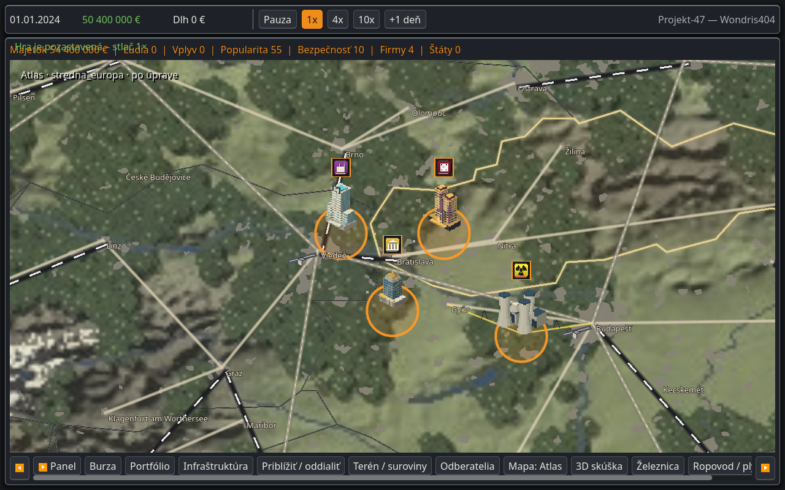
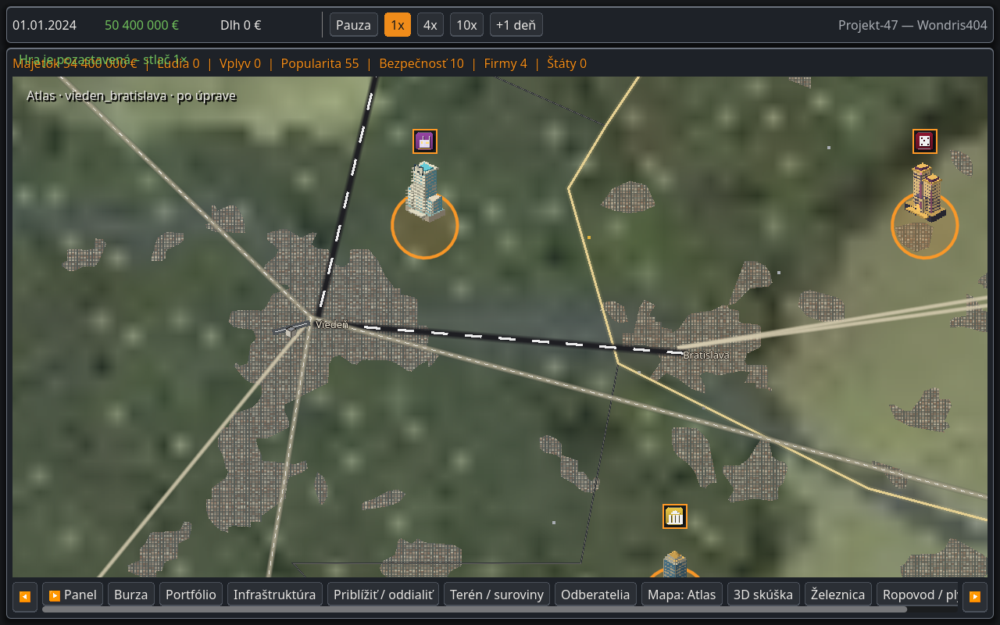

# Atlas: oprava gigantických miest

30. 10. 2026 — na žiadosť hráča po kontrole screenshotov budov.

## Čo spôsobovalo chybu

Pôvodný `TerrainSystem.cities()` dáva každému mestu herný polomer najmenej 1,5 svetovej jednotky, teda približne **42 km v severojužnom smere**. Atlas používal tento servisný polomer aj na izometrické zhluky alebo detailné siete ulíc. Nešlo o skutočnú zastavanú plochu; viedlo to ku gigantickým mestám.

## Oprava

Atlas teraz kreslí 11 878 geografických zastavaných oblastí z Natural Earth. Veľkosť a tvar pochádzajú zo súradníc obrysu, s rovnakou projekciou ako mapa. Pri priblížení pribudne dekoratívna pixelová textúra blokov, ale pôdorys sa nemení. Nie sú tu minimálne zväčšené kruhy ani niekoľko kópií jednej aglomerácie. Popisky ostávajú pri skutočných súradniciach miest.

Bratislava má v podklade obálku približne **22 × 21 km**, s nepravidelným obrysom. Viditeľná krajina medzi Bratislavou a Viedňou už nie je zakrytá zväčšenými zhlukmi. Veľké aglomerácie ako Paríž a Tokio majú aj skutočne veľký rozsah; nezmenšujú sa všetky mestá rovnakým násobiteľom.

Schválené modely podnikov a ich upgrady sa nemenia. Ide o symboly podnikov, nie o budovy v geografickej mierke. Herné servisné oblasti/stavebné pravidlá zostávajú pôvodné, aby sa nemenila ekonomika ani platnosť existujúcich umiestnení v save v3. Táto oprava mení vizuálny rozsah mestských plôch iba v Atlase.

## Porovnanie z hry

Godot 4.7.2, Xvfb, Mesa llvmpipe, 1280 × 800. Rovnaká kamera a pozastavený testovací svet v každom páre; nie používateľov save. Základ pred úpravou: `972cc7b`.

| Pohľad | Pred | Po |
|---|---|---|
| Stredná Európa a schválené podniky | [PNG](stredna_europa_before.png) | [PNG](stredna_europa_after.png) |
| Viedeň – Bratislava, detail | [PNG](vieden_bratislava_before.png) | [PNG](vieden_bratislava_after.png) |
| Paríž a predmestia | [PNG](pariz_before.png) | [PNG](pariz_after.png) |
| Tokio a aglomerácia | [PNG](tokio_before.png) | [PNG](tokio_after.png) |





## Zdroje, overenie a limity

[Licencia public domain, presný pôvod, hash, transformácia a audit](../../data/atlas/README.md). Natural Earth poskytuje generalizované satelitné obrysy s historickým podkladom MODIS, nie presné hranice roku 2026. Dekoratívne mestské bloky nepredstavujú reálnu sieť ulíc. Menšie sídla mimo datasetu sa nenahrádzajú obrovským kruhom.

Prešlo **41 cielených kontrol**: 10 nových geografických/prezentačných, 22 existujúcich Atlas regresií a 9 kamery. Nové kontroly overujú pokrytie Bratislavy, Viedne, Paríža a Tokia, voľnú krajinu medzi Bratislavou a Viedňou, rozmery, zachovanie dier, mierku, Atlas-only zobrazenie a nemennosť save/RNG. [Výpis](validation.txt). Generátor navyše kontroluje plochu každej triangulácie; žiadny rozsiahly herný testovací balík sa nespúšťal.

Exportný filter explicitne zahŕňa `data/atlas/*.json`. Overený aj export PCK a zopakovaných rovnakých 10 geografických kontrol z balíka v prázdnom pracovnom adresári, bez čítania dát zo zdrojového projektu. Nejde o test spustenia Windows EXE.

```bash
godot --headless --path . -- atlas_city_scale_unit
godot --headless --path . -- atlas_update_unit
godot --headless --path . -- camera_unit
xvfb-run -a env LIBGL_ALWAYS_SOFTWARE=1 GALLIUM_DRIVER=llvmpipe godot \
  --path . --rendering-method gl_compatibility --audio-driver Dummy \
  --resolution 1280x800 -- atlas_cities_capture after
```

Použi Godot 4.7.2 a oddelené `XDG_DATA_HOME`. Jednorazové časy `draw_ms` v JSON nie sú benchmark FPS ani čas vykreslenia celého snímku. Výkon na hráčovom GPU ostáva neoverený. Pôvodný terén má pri veľkom priblížení stále nízke rozlíšenie.
