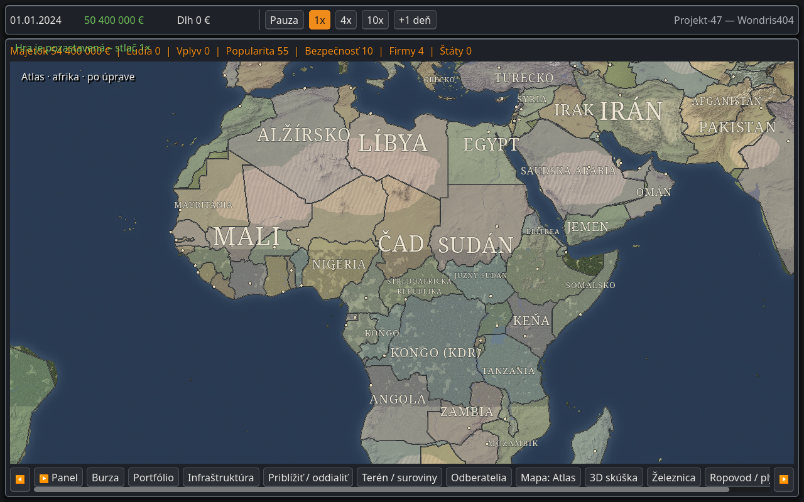
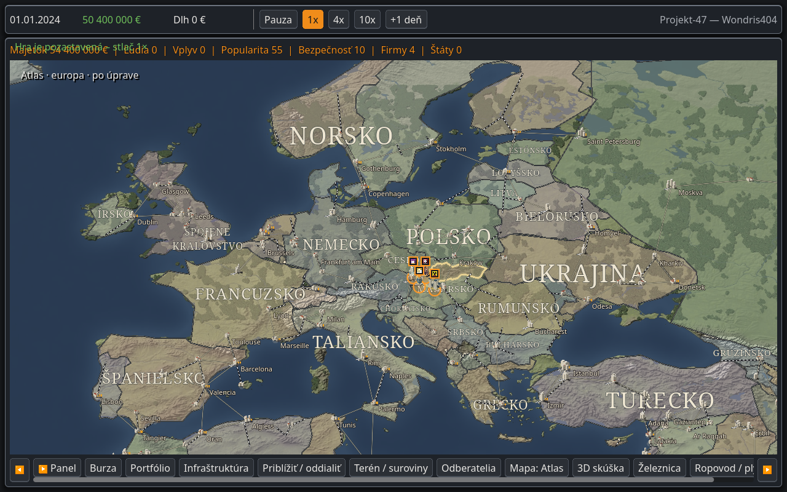

# Atlas: mapa podľa vizuálnej predlohy HOI4

Dokončené 30. 10. 2026. Úprava nadväzuje na schválené výškové modely banky, kasína a hotela. Predlohou je používateľov **Dokument bez názvu.pdf**, predovšetkým politická mapa Afriky na prvej strane a odkaz na [GFX Remastered_l](https://steamcommunity.com/workshop/filedetails/?id=2668719344).

## Výsledok

- Tlmenejšie politické farby nad viditeľným reliéfom, tmavomodré more a tlmená farebnosť pôvodného terénu.
- Dvojitá jemná hranica a svetlozlaté zvýraznenie vybraného/hráčovho štátu.
- Veľké krémové serifové názvy krajín v slovenčine. Dlhé názvy sa zalomia, menšie ustúpia väčším pri kolízii, pri priblížení postupne zmiznú.
- Menej výrazné diaľnice; prístavné a letiskové dekorácie a mestské modely sa zobrazujú až pri bližšom pohľade. Detail uličnej siete závisí od veľkosti mesta na obrazovke. Mestské popisky sa vzájomne neprekrývajú ani neprekrývajú zobrazené názvy štátov.
- Všetko sa týka iba Atlasu. Existujúce UI ikony, schválené PNG budov, ekonomika, RNG a save v3 zostávajú pôvodné. Geografia a hranice používajú existujúce herné dáta; alternatívne historické vlastníctvo území z HOI4 screenshotu sa nepreberá. Nepribudli nové provincie ani vojnové mechaniky.

## Skutočné herné screenshoty

Godot 4.7.2, Xvfb, OpenGL Compatibility, Mesa llvmpipe, 1280 × 800. Rovnaké pozície a mierky kamery pred úpravou a po nej, päť pohľadov. Štyri podniky sú pozastavená testovacia zostava pri Bratislave, nie používateľov save. Banka je L1, hotel a kasíno L3; ich schválená grafika je nezmenená.

| Pohľad | Pred úpravou | Po úprave |
|---|---|---|
| Svet | [PNG](svet_before.png) | [PNG](svet_after.png) |
| Afrika — najbližšie k predlohe | [PNG](afrika_before.png) | [PNG](afrika_after.png) |
| Európa | [PNG](europa_before.png) | [PNG](europa_after.png) |
| Slovensko | [PNG](slovensko_before.png) | [PNG](slovensko_after.png) |
| Bratislava a schválené budovy | [PNG](bratislava_before.png) | [PNG](bratislava_after.png) |





## Zdroje a licencie

- **HOI4/mod:** iba vizuálna referencia z dodaného PDF. Žiadne textúry, fonty ani modely z modu neboli skopírované.
- **Terén:** existujúce `assets/atlas/`, podľa pôvodného denníka projektu Natural Earth (public domain) a vlastné procedúry. V tejto zmene sa rastre a geografické dáta nemenia. Nový vlastný shader mení ich farebnosť pri vykreslení. [Podmienky Natural Earth](https://www.naturalearthdata.com/about/terms-of-use/).
- **Noto Serif:** Copyright 2022 The Noto Project Authors, [projekt](https://github.com/notofonts/latin-greek-cyrillic), **SIL Open Font License 1.1**. [Zdroj fontu](https://github.com/google/fonts/tree/main/ofl/notoserif), [lokálny plný text licencie](../../assets/fonts/OFL-NotoSerif.txt), súbor `assets/fonts/NotoSerif-Variable.ttf`. Používa sa iba pre názvy krajín v Atlase; nemení font ostatného UI.
- **Nový kód a štýl:** vlastná implementácia v tomto repozitári, bez prevzatých modových aktív a bez udeľovania novej verejnej licencie projektu.

## Overenie a reprodukcia

Prešlo **41 cielených kontrol**: 10 prezentačných kontrol, 22 existujúcich Atlas regresií a 9 kontrol kamery. [Výpis](validation.txt). Test nemennosti stavu najprv inicializuje existujúce voliteľné Empire polia, ktoré pôvodná zákaznícka vrstva vytvára lenivo; potom porovná celý uložený stav a RNG.

```bash
godot --headless --path . -- atlas_style_unit
godot --headless --path . -- atlas_update_unit
godot --headless --path . -- camera_unit
xvfb-run -a env LIBGL_ALWAYS_SOFTWARE=1 GALLIUM_DRIVER=llvmpipe godot \
  --path . --rendering-method gl_compatibility --audio-driver Dummy \
  --resolution 1280x800 -- atlas_style_capture after
```

Použi Godot 4.7.2 a oddelené `XDG_DATA_HOME` pre zachytávanie. Scenár je v `tests/atlas_style_capture.gd`, neukladá hru. Snímky `before` vznikli na základe `d4150d0` s rovnakým zachytávacím scenárom; opisný nápis bol následne posunutý z hornej lišty do mapy. JSON súbory zaznamenávajú renderer a kameru. Jednorazové `draw_ms` nie sú benchmark FPS.

Otvorené: posúdenie finálneho vzhľadu hráčom a výkon na jeho GPU. Pôvodný podklad má obmedzené rozlíšenie pri veľkom zoome a viditeľný polárny pás pri oddialení; táto úprava ho nenahrádza. Používateľské rozhranie a jeho existujúce rozloženie ostali mimo rozsahu.
