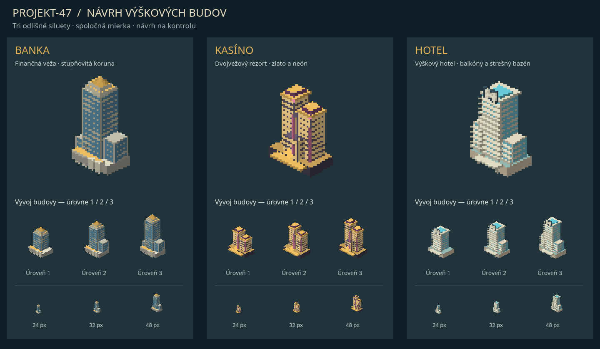

# Návrh: výšková banka, kasíno a hotel

Návrh na kontrolu, **zatiaľ nezapojený do hry**. Všetky tri typy sú vysoké už na prvej úrovni. Deväť modelov používa spoločnú kameru a mierku, úrovne pridávajú poschodia a nové krídla.



- **Banka:** finančná veža s tmavým presklením, kamenným stĺpovým vstupom a zlatou stupňovitou korunou. L2 pridáva bočné kancelárske krídlo, L3 ďalšie poschodia a prednú prístavbu.
- **Kasíno:** dve výškovo odstupňované veže, zlaté rímsy, fialovoružové svetelné pásy a diamantový znak vstupu. L2 má spojovací most, L3 ďalší blok nad vstupným podlažím.
- **Hotel:** svetlá výšková budova s pásmi balkónov, presklením, krytým príjazdom a bazénom na streche. L2 pridáva bočné krídlo, L3 druhé vyššie krídlo.

Samostatné náhľady: [banka](bank.png), [kasíno](casino.png), [hotel](hotel.png). Dolný riadok ukazuje L3 pri 24, 32 a 48 px. Pri banke sú L2/L3 stále iba vizuálne varianty; tento návrh nevytvára nový bankový upgrade systém.

Pôvod: vlastná procedurálna pixelová tvorba pre Projekt-47 (`LicenseRef-Projekt47-Original`), bez cudzích modelov, textúr či log. Náhľad vykreslil Godot 4.7.2 cez Xvfb a Mesa llvmpipe. Nie je to snímka nasadenej hernej mapy. Existujúce modely, UI a save formát sa nezmenili.

Reprodukcia (Python 3, Pillow, Godot 4.7.2, existujúci Xvfb displej):

```bash
python tools/atlas/propose_towers.py
DISPLAY=:47 LIBGL_ALWAYS_SOFTWARE=1 GALLIUM_DRIVER=llvmpipe godot --path . --rendering-method gl_compatibility --audio-driver Dummy --resolution 1440x840 --script res://tools/atlas/capture_towers.gd
```
