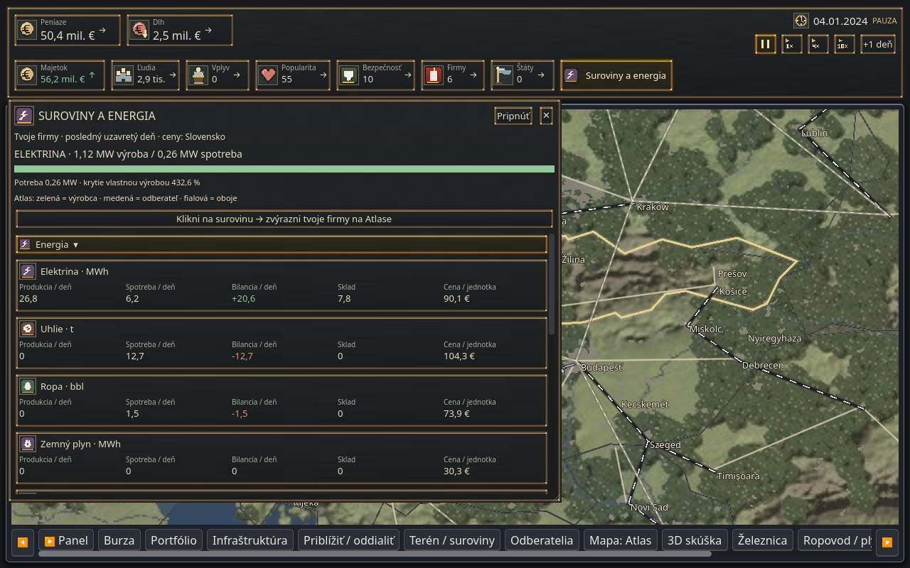
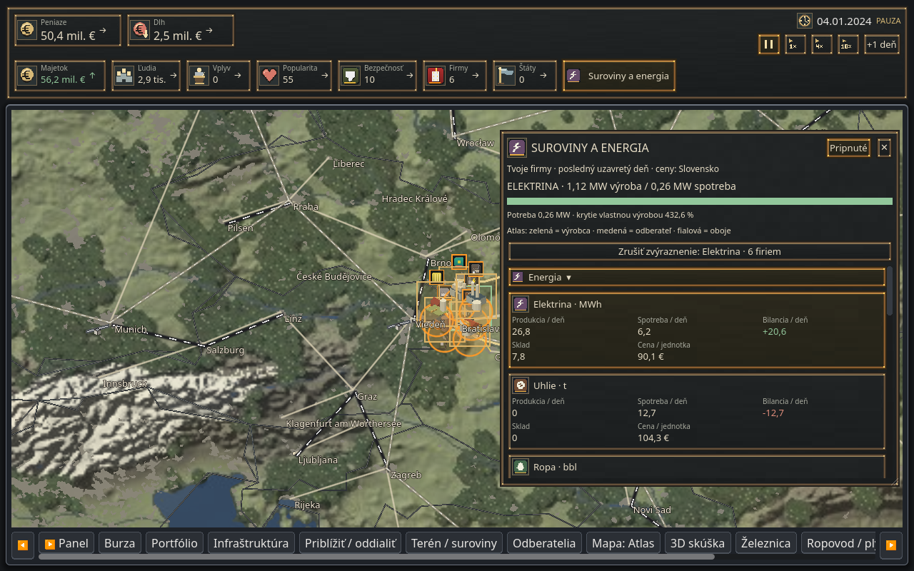

# Strategická horná lišta a panel surovín

30. 10. 2026. Vlastná implementácia vizuálne inšpirovaná strategickým UI HOI4, zasadená do Atlasu. Nepreberá kód ani grafiku hry/modu.

## Ovládanie a vzhľad

Horná lišta zobrazuje peniaze, dlh, majetok, ľudí, vplyv, popularitu, bezpečnosť, firmy a vlastnené štáty v tmavých políčkach s bronzovým 9-slice rámom. Peniaze a dlh majú väčší text, napríklad **50,4 mil. €**. Každý ukazovateľ má tooltip so zdrojom a dennou zmenou. Rast je zelený a pokles červený; pri dlhu je význam obrátený (rast dlhu červený). Šípka ukazuje smer aj bez rozlišovania farby.

Dátum, stav pauzy a ovládanie Pauza / 1× / 4× / 10× / +1 deň sú vpravo hore. Zachovávajú pôvodné rýchlosti simulácie (1,2 / 6 / 24 dní za sekundu). Pri úzkom okne sa políčka zalomia a ovládanie sa prispôsobí dostupnej šírke. Dočasná spätná väzba už neprekrýva ukazovatele.

Tlačidlo **Suroviny a energia** otvára panel s krátkym vysunutím a prelínaním. **Pripnúť** ho ponechá otvorený pri kliknutí mimo neho. Presúva sa za hlavičku a veľkosť sa mení za okraje/pravý dolný roh. Poloha a veľkosť používajú existujúce UI nastavenia, nie save hry. Nepripnutý panel zatvorí kliknutie mimo; Esc alebo ✕ zatvorí aj pripnutý panel.

Panel obsahuje všetkých 28 komodít v skupinách Energia, Suroviny, Polotovary a Výrobky. Produkcia, spotreba, bilancia, sklad a cena majú vlastné polia. Pri zúžení sa päť polí zalomí do dvoch riadkov, obsah sa posúva zvislo. Uhlie, železnú rudu a mäso odlišuje sivomodrý, medený a vínový podklad.

Kliknutie na komoditu zvýrazní **vlastné aktívne firmy** na Atlase podľa všetkých ich výrobných receptov: zelená výrobca, medená odberateľ, fialová oboje. Opätovný klik, tlačidlo zrušenia alebo zatvorenie panelu zvýraznenie vymaže. Výber nemení nastavenia výroby ani schválené modely budov. Firma môže byť zvýraznená podľa schopnosti receptu aj keď posledný deň reálne nevyrábala.

## Význam údajov

- Ukazovatele používajú existujúce `Empire.stats()`, `GameState.debt()` a hodnoty portfólia. Denné trendy sa vzorkujú počas relácie; po načítaní iného sveta sa resetujú. Bez predchádzajúceho odpočtu sa zmena označí ako nemeraná, nevymýšľa sa história.
- Produkcia a spotreba sú **skutočné toky za posledný uzavretý deň vlastných firiem**, nie objemy kúpené/predané na trhu ani odhad podľa skladov. Záznam preberá výsledok `apply_spec`; službové prevádzky zahŕňajú aj účtované vstupy. Obchodné prekupovanie sa nevydáva za výrobu.
- Nový záznam sa publikuje až pri dokončení celého dňa, takže postupné spracovanie simulácie nezobrazuje zmiešané údaje. Je iba v pamäti. Po štarte/načítaní sú denné toky „—“ do prvého uzavretia dňa, sklady a ceny sú dostupné ihneď.
- Sklad je súčet inventárov vlastných aktívnych prevádzok. Cena je **referenčná trhová cena aktuálne vybranej krajiny**, uvedenej v podtitule; nejde o priemernú realizovanú predajnú cenu všetkých firiem.
- Denná elektrická energia v MWh sa delí 24: panel tak ukazuje **priemerný denný výkon v MW**, nie menovitý výkon elektrární. Samostatne uvádza skutočný odber a požadovaný odber pred obmedzením výroby.
- Energetická lišta meria krytie požadovaného odberu vlastnou výrobou: zelená ≥100 %, oranžová 90–100 %, červená <90 %. Deficit vlastnej výroby môže pokryť trh; lišta netvrdí, že ide o výpadok siete. Pri nulovom odbere alebo chýbajúcich údajoch je neutrálna.

Ekonomické výpočty, zásoby a RNG sa zobrazovaním nemenia. Žiadne nové polia nie sú ukladané do save; **v3 ostáva spätne kompatibilný**. Pôvodné súbory projektu sa nemažú.

## Grafika a zdroje

[11 vlastných 32px ikon a dva 9-slice rámy](../../assets/ui/strategic/README.md). Pôvodné ikony komodít a budov sú zachované. Font používa existujúcu UI tému. Export zahŕňa aj existujúce licenčné texty fontov. Žiadne prevzaté aktíva HOI4, GFX Remastered alebo Sketchfab.

## Screenshoty z hry

Godot 4.7.2, Xvfb, OpenGL Compatibility, Mesa llvmpipe. Pozastavený testovací svet so šiestimi skutočnými podnikmi; zobrazené denné toky vznikli simuláciou, nie ručne dopísanými hodnotami. Základ pred úpravou: `23071bd`. Bežné okno 1280 × 800, malé 960 × 720 s nastavením UI 150 %.

| Pohľad | Snímka |
|---|---|
| Pôvodná lišta | [Pred](normal_before.png) |
| Nová lišta, rovnaký počiatočný stav | [Po](normal_after.png) |
| Lišta po uzavretí dvoch dní | [Denné trendy](normal_live.png) |
| Skutočný tooltip majetku | [Tooltip](metric_tooltip.png) |
| Produkcia, spotreba, energia | [Otvorený panel](resources_after.png) |
| Presunutý a zmenšený pripnutý panel | [Zvýraznené firmy](pinned_highlight.png) |
| Posledné položky zoznamu | [Výrobky po posunutí](products_scrolled.png) |
| Malé okno, UI 150 % | [Pred](small_150_before.png) · [Po](small_150_after.png) |
| Malé okno s pripnutým panelom | [Panel pri 150 %](small_150_panel.png) |





## Overenie a výkon

**50 cielených kontrol:** 16 dátových a kompatibility, 18 GUI, 9 existujúcich kontrol kamery a 7 pôvodných kontrol komoditných ikon. GUI scenár používa skutočné udalosti myši a klávesnice: hodiny, jeden deň, vysunutie, výber suroviny, pripnutie, drag, resize, posúvanie až na poslednú komoditu, malé okno/150 %, Esc a zatvorenie kliknutím mimo. [Log overenia](validation.txt), [GUI výsledky a diagnostické časovanie](capture_after.json).

Textúry sú malé a cachované, používa sa 9-slice bez blur efektov. Viditeľný panel sa aktualizuje cez existujúci limit UI 5× za sekundu; zatvorený panel neprepočítava riadky. Denná vzorka trendov je oddelená od obnovy textu. Animácia používa Tween iba počas otvorenia/zatvorenia. Zvýraznenie mapy sú jednoduché obdĺžniky.

Diagnostika v JSON meria iba CPU čas 30 obnovení HUD v testovacom svete so šiestimi firmami. Nie je to FPS benchmark ani dôkaz výkonu na integrovanej AMD grafike; tá v tomto prostredí nie je dostupná. Vizuálny render a ovládanie boli overené softvérovým rendererom.

```bash
godot --headless --path . -- strategic_hud_unit
godot --headless --path . -- camera_unit
godot --headless --path . -- goods_icons_unit
xvfb-run -a env LIBGL_ALWAYS_SOFTWARE=1 GALLIUM_DRIVER=llvmpipe godot \
  --path . --rendering-method gl_compatibility --audio-driver Dummy \
  --resolution 1280x800 -- strategic_hud_capture after
```

Použi Godot 4.7.2 a oddelené `XDG_DATA_HOME`. Scenár nevytvára používateľský save a vypína ukladanie polohy testovacích okien. Finálne posúdenie grafiky a výkonu na hráčovom AMD zostáva na jeho zariadení.

Export PCK prešiel bez chýb. Rovnakých 16 dátových kontrol prešlo aj z exportovaného balíka v prázdnom pracovnom adresári. Overené zahrnutie nových ikon a licenčného textu fontu; Windows EXE sa tu nespúšťal. Bajtová kontrola potvrdila nezmenené pôvodné ikony komodít a budov.
